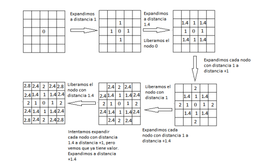

# PRACTICA 4

> **Nota:** A partir de esta práctica empecé a utilizar Ruff y autopep8 para adaptar el código a la guía de estilos. Queda pendiente de consultar con los profesores.
{: .prompt-warning }

## 1. Video de resolución


## 2. Explicación de la solución

### 2.1. Preparación de la cuadrícula
Para comenzar la práctica necesitaba representar el mapa mediante una cuadrícula sobre la que posteriormente pudiera implementar el algoritmo de planificación global.

Para ello, utilizo la matriz obtenida mediante el mapa proporcionado, diferenciando las celdas transitables de los obstáculos mediante los siguientes valores:

- **LIBRE = 255**: celdas transitables.
- **OBSTACULO = 0**: celdas ocupadas.

### 2.2. Inversión de la cuadrícula
Una vez preparada la cuadrícula, realicé una prueba de inversión para comprobar que la representación del mapa funcionaba correctamente.

Esta comprobación me permitió verificar la correspondencia entre los valores de la matriz y su representación visual antes de comenzar con la planificación de rutas.



### 2.3. Planteamiento del algoritmo Wavefront
Una vez preparada la cuadrícula, comencé a plantear la implementación del algoritmo Wavefront.

Este algoritmo permite obtener un campo de costes mediante la expansión desde la celda objetivo.

Para ello, inicializo una matriz de costes donde el objetivo tiene un valor de 0 y las celdas pendientes de visitar tienen un valor de -1, idea que saqué guiandome de la imagen adjunta en el enunciado de JDROBOT.

He considerado dos costes de desplazamiento según las idicaciones de la práctica:

- **Horizontal y vertical:** coste de 1.
- **Diagonal:** coste de 1.4.

Para realizar la expansión utilicé una cola de prioridad, procesando las celdas pendientes en función de su coste acumulado, como se indicaba en las pistas de la web de JDROBOT.

### 2.3.1. Expansión de nodos
Para realizar la expansión de cada nodo, considero los ocho vecinos de la celda que estoy procesando.

Antes de asignar un coste a cada vecino, compruebo que se encuentre dentro de los límites del mapa y que no corresponda a un obstáculo.

Una vez realizadas estas comprobaciones, calculo su coste sumando al coste de la celda actual el correspondiente al desplazamiento realizado, diferenciando entre movimientos laterales y diagonales.

Si el vecino todavía no ha sido visitado o el nuevo coste es menor que el que tenía asignado anteriormente, actualizo su valor en la matriz de costes y lo añado a la cola de prioridad.

De esta manera, se procesan primero las celdas con menor coste acumulado.

### 2.3.2. Campo de penalización
Además del campo de propagación hacia el destino, es necesario tener en cuenta la cercanía a los obstáculos para evitar que el coche circule demasiado próximo a los edificios.

Para ello, inicializo una segunda matriz con valores de 0 y localizo todas las celdas correspondientes a obstáculos del mapa.

A continuación, recorro los ocho vecinos de cada obstáculo y añado un peso adicional de 2 a aquellos que sean transitables como se indicó en clase.

Si una celda es vecina de varios obstáculos, acumula las penalizaciones correspondientes a cada uno de ellos.

Como este campo depende únicamente de los obstáculos presentes en el mapa y no del destino seleccionado, solo necesito calcularlo una vez, antes de comenzar el bucle principal.

### 2.3.3. Campo de propagación (path planning)
Para calcular el campo de propagación, comienzo desde la celda correspondiente al destino seleccionado por el usuario.

Introduzco esta celda en la cola de prioridad con un coste de 0 y comienzo a expandir sus vecinos siguiendo el procedimiento explicado anteriormente.

La expansión continúa procesando las celdas con menor coste acumulado hasta alcanzar la posición actual del coche.

De esta forma, obtengo un campo escalar en el que los costes representan el coste de desplazamiento por la cuadrícula hasta el destino, teniendo en cuenta los obstáculos del mapa.

Aunque la expansión se realiza desde el destino hacia el coche, posteriormente el coche recorrerá este campo en sentido contrario, siguiendo los costes decrecientes.

### 2.3.4. Combinación de campos
Una vez calculados los dos subcampos, obtengo el campo total mediante la suma del campo de propagación y el campo de penalización.

$$
C_{total} = C_{propagación} + C_{penalización}
$$

Para realizar esta suma, tengo en cuenta únicamente las celdas que han recibido un coste durante la expansión, manteniendo el valor de -1 en aquellas que no han sido visitadas, como se indica en el enunciado.
De esta manera, el campo resultante proporciona información tanto del coste necesario para llegar al destino como de la cercanía a los obstáculos.

El campo de propagación se vuelve a calcular cada vez que el usuario selecciona un nuevo destino, mientras que el campo de penalización se mantiene constante.

### 2.3.5. Visualización de campos y efectividad con puntos locales y circunferencias
Para comprobar el funcionamiento de la planificación, representé visualmente los campos de costes sobre el mapa.

Como los costes calculados no están limitados al rango de una imagen en escala de grises, fue necesario normalizar sus valores entre 0 y 255.

Esta representación me permitió comprobar cómo se propagaban los costes desde el destino seleccionado y cómo la presencia de los obstáculos condicionaba la forma de la expansión.



La expansión tiene un comportamiento similar al de una onda que se propaga desde el destino. Sin embargo, debido a la geometría de la cuadrícula y a la presencia de edificios, no presenta una forma circular perfecta.

Durante las primeras pruebas de navegación, observé que seleccionar únicamente la celda vecina con menor coste no era suficiente para realizar correctamente algunas curvas. Observaba el coche chocarse con alguna esquina cuando seleccionaba un destino cercano a ésta.
Por ello, siguiendo las indicaciones de la práctica, comencé a considerar dos objetivos locales consecutivos, permitiendo que el coche tuviera en cuenta no solo la dirección inmediata, sino también la dirección que debía seguir posteriormente. En el vídeo solución selecciono el punto que me daba problemas sin los vecinos consecutivos, siendo observable la efectividad de dicha implmentación.

### 2.4. Navegación
Una vez obtenido el campo total, implementé la navegación del coche mediante un bucle reactivo a una frecuencia de 10 Hz, lo cual es una decisión personal que suelo tomar para la mayoría de mis prácticas; aunque podría tener en cuenta que de serie el bucle corre a una frecuencia concreta, 10 Hz se me hace muy manejable por las propiedades del número 10.

En cada iteración obtengo la posición y orientación actual del coche y convierto su posición a coordenadas de la cuadrícula para consultar el campo de costes. A diferencia de las prácticas más avanzadas de Unibotics, esta vez la conversión viene casi dada ya que tenemos funciones concretas que lo calculan, lo cual me ahorró muchísimo tiempo aunque ya implementé las conversiones para Robótica de Servicio.

Volviendo a la práctica, para seleccionar el primer objetivo local, recorro los ocho vecinos de la posición actual y selecciono aquel que tenga el menor coste, descartando los obstáculos y las celdas que no hayan sido visitadas.

A continuación, realizo el mismo procedimiento desde el primer objetivo para obtener un segundo objetivo local.

La utilización de estos dos puntos permite anticipar los cambios de dirección durante la navegación.

Una vez seleccionados los objetivos, convierto sus coordenadas de la cuadrícula a coordenadas del mundo y calculo dos vectores:

- Un primer vector desde la posición actual del coche hasta el primer objetivo.
- Un segundo vector desde el primer objetivo hasta el segundo.

Para calcular la dirección que debe seguir el coche, combino ambos vectores, dando mayor importancia al primero y utilizando el segundo para anticipar el siguiente movimiento (Como es indicado en el enunciado para proporcionar efectividad).

$$
\vec{d} = \vec{d_1} + 0.5\vec{d_2}
$$

A partir de esta dirección, calculo el ángulo objetivo y el error angular respecto a la orientación actual del coche.

El error angular se normaliza entre $-\pi$ y $\pi$ para obtener el sentido de giro correspondiente, comportamiento que también tengo como hábito en todas mis prácticas.

Finalmente, utilizo un controlador proporcional para gobernar la velocidad angular del coche, manteniendo una velocidad lineal de 3 m/s durante la navegación. Descarté complicar el controlador, porque no observé oscilaciones y tampoco era necesario.

$$
W = K_p \cdot e_{\theta}
$$

$$
V = 3 \ m/s
$$

En cada iteración se vuelven a seleccionar los objetivos locales a partir de la nueva posición del coche. Por tanto, no es necesario calcular una trayectoria completa previamente, sino que el coche utiliza el campo de costes como un recurso para decidir hacia dónde desplazarse en cada momento siguiendo el gradiente. Esto se dijo muchas veces en clase.

Para detectar la llegada al destino, compruebo la distancia entre la posición actual del coche y el objetivo final seleccionado por el usuario ya que en una primera implementación el coche se quedaba dándole vueltas al destino sin parar.
Cuando esta distancia es inferior a 2 metros, detengo el coche estableciendo ambas velocidades a 0. Además, utilizo una variable booleana para indicar que el destino ha sido alcanzado y mantener el coche detenido hasta que el usuario seleccione un nuevo destino. Esta variable también permite mostrar el mensaje de llegada una única vez.

## 3. Resultado
Como resultado de la práctica, he conseguido implementar un taxi autónomo capaz de planificar su navegación mediante el algoritmo Gradient Path Planning.

El coche obtiene un campo de costes a partir de la combinación del campo de propagación hacia el destino y el campo de penalización por cercanía a obstáculos.

Mediante la selección de dos objetivos locales consecutivos y un controlador proporcional, el coche navega de manera reactiva hacia el destino seleccionado.

Una vez alcanzado el destino, el coche permanece detenido hasta que el usuario selecciona otro punto del mapa, momento en el que se calcula un nuevo campo de costes y comienza de nuevo la navegación.